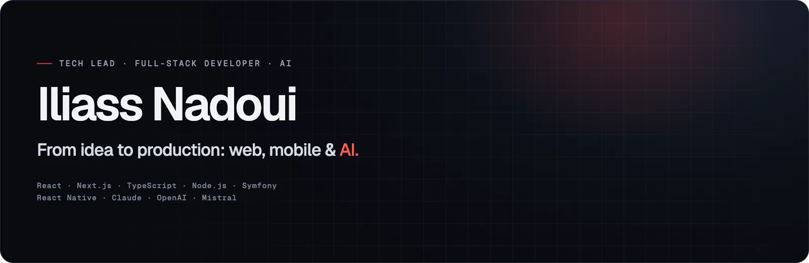
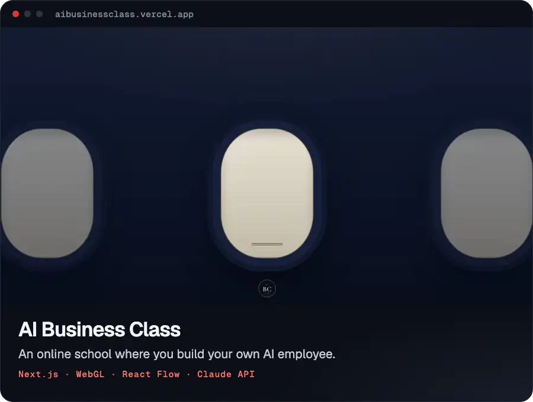
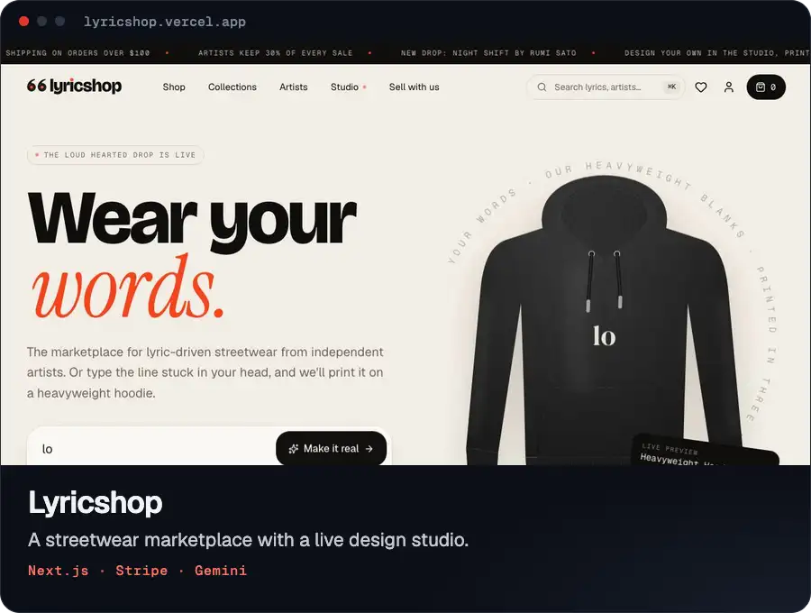
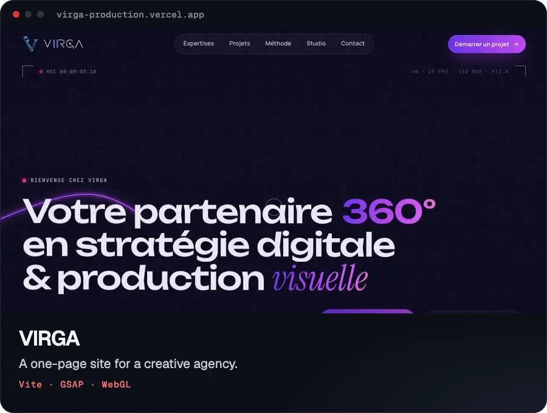
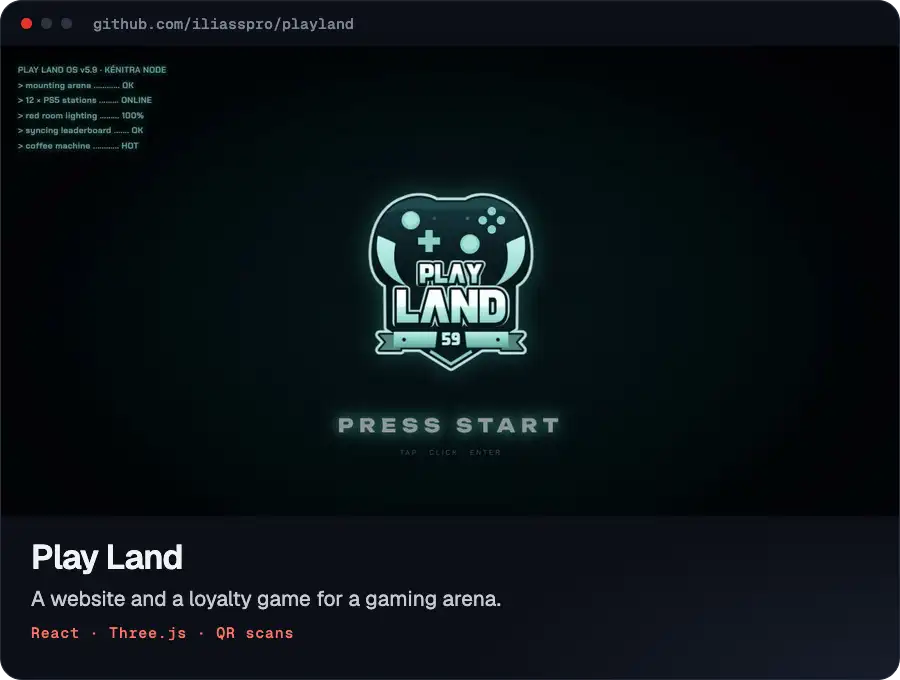
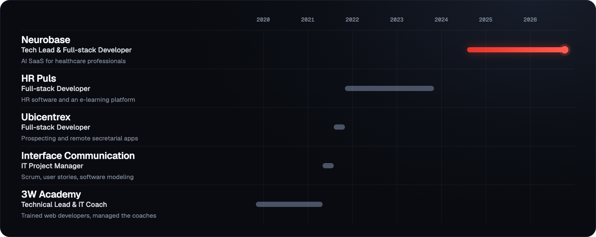

  

I build web and mobile apps, and add AI when it actually helps. I also run IT projects and train developers.

Most of my day job lives in private repos, which is why the graph below looks busy and the list of projects looks short. These four I can show.

<h3>Selected work</h3>

  
  

  
  

<h3>Experience</h3>

<h3>Say hi</h3>

[LinkedIn](https://www.linkedin.com/in/iliass-nadoui/) · [iliasspro1@gmail.com](mailto:iliasspro1@gmail.com)
